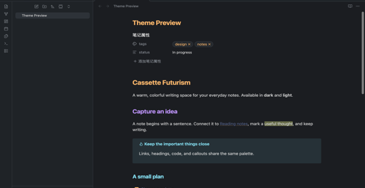
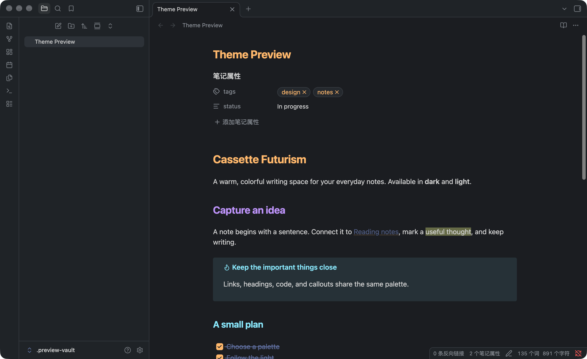
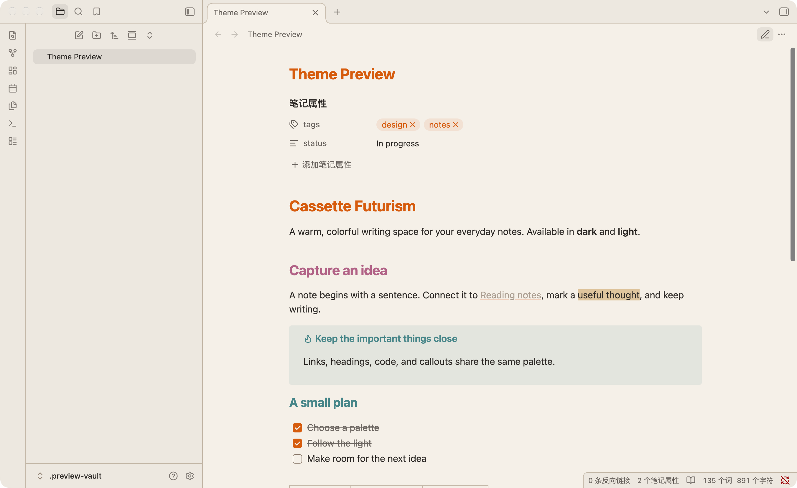

# Cassette Futurism — Obsidian Theme

A retro-futuristic theme for [Obsidian](https://obsidian.md), inspired by 1970s and 1980s sci-fi interfaces, CRT monitors, NASA mission control consoles, and vintage computing aesthetics.

Supports both **Dark** and **Light** modes out of the box with zero plugins and zero configuration required.



## Modes

| Mode | Paradigm | Base | Accent Highlights |
|---|---|---|---|
| **Dark ("Magnetic Night")** | Analog CRT console | Deep steel-gray (`#1a1d21`) | Amber glow, phosphor green, signal cyan |
| **Light ("Beige Terminal")** | Vintage workstation | Warm beige (`#f5f0e8`) | Retro rainbow accents, deep crimson, high-contrast ink |





## Features

- **CSS only**: No plugin dependency or JavaScript.
- **Local assets**: No remote fonts, images, or network requests.
- **Native appearance modes**: Follows Obsidian's dark and light settings.
- **Full Markdown Coverage**: Styled headings, code blocks, inline code, callouts, blockquotes, tables, tags, checkboxes, search results, and canvas cards.
- **Syntax Highlighting**: Dedicated token coloring for both Live Preview (CodeMirror) and Reading View (Prism).

## Installation

### Obsidian Community Themes

Available in the [Obsidian Community directory](https://community.obsidian.md/themes/cassette-futurism). Use **Add to Obsidian** on that page, or install from within the app:

1. Open **Settings** → **Appearance**.
2. Under **Themes**, click **Browse**.
3. Search for **Cassette Futurism**.
4. Click **Install and use**.

### Manual Installation

1. Go to the [Releases](https://github.com/taotao7/obsidian-cassette-futurism/releases) page.
2. Download `manifest.json` and `theme.css`.
3. In your Obsidian vault, navigate to (or create) `.obsidian/themes/Cassette Futurism/`.
4. Copy `manifest.json` and `theme.css` into that folder:
   ```text
   <your-vault>/
   └── .obsidian/
       └── themes/
           └── Cassette Futurism/
               ├── manifest.json
               └── theme.css
   ```
5. Open Obsidian, go to **Settings** → **Appearance** → **Themes**, and select **Cassette Futurism**.

To toggle between dark and light modes, use Obsidian's standard setting (**Settings** → **Appearance** → **Base color scheme**) or the command palette (*Switch between light and dark mode*).

## Building from Source

The stylesheet is deterministically generated from `palette.toml` using a Python standard-library generator (Python 3.11+ required for `tomllib`).

```bash
# Clone the repository
git clone https://github.com/taotao7/obsidian-cassette-futurism.git
cd obsidian-cassette-futurism

# Regenerate manifest.json and theme.css
python3 generate.py
```

## Attribution & License

- Palette and design principles originated from [`taotao7/theme-tape`](https://github.com/taotao7/theme-tape) and [`taotao7/cassette-futurism`](https://github.com/taotao7/cassette-futurism).
- Released under the [MIT License](LICENSE).
